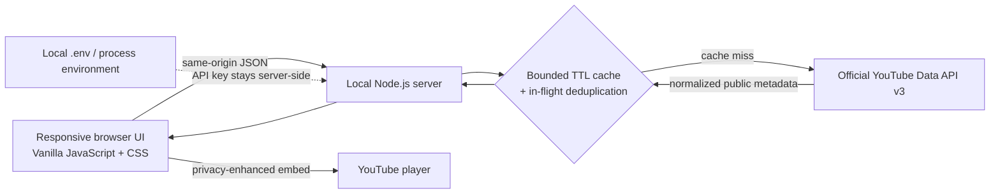

# Signal

> **YouTube discovery, tuned to what you’re looking for.**


Signal is a local-first video and livestream discovery app built around a simple idea: finding something worth watching should feel deliberate, not like sorting through noise. Search videos and creators, scan what is live now, see what is coming up, and open a YouTube player without leaving the discovery flow.

It uses the **official YouTube Data API v3** for discovery and metadata, and YouTube’s privacy-enhanced embed for playback. It does not scrape YouTube pages, invent sample results, or send the API key to the browser.

## Why Signal

Most video search results are optimized for volume. Signal brings a calmer, more legible layer to the same public YouTube catalog: clear broadcast status, useful context, channel exploration, and playback in one responsive interface. Its visual direction is editorial rather than dashboard-like—warm paper tones, deep green, restrained live accents, generous typography, and quiet motion.

## What you can do

- **Search videos and creators.** Search titles, channels, and topics. Sort by relevance, newest, views, or rating. Filter regular videos by length.
- **Discover live broadcasts.** Browse current broadcasts broadly or narrow the list with an optional topic or channel phrase. Cards distinguish live content and show concurrent viewers when YouTube provides them.
- **Find upcoming streams.** Browse scheduled broadcasts or narrow by topic. Scheduled start times are presented in the viewer’s local time zone when available.
- **Explore a channel.** Open a channel from a result and switch between its uploads, current live broadcasts, and upcoming broadcasts. Each list supports pagination.
- **Watch with context.** Open a video to see its description, available statistics, channel details, and an official privacy-enhanced YouTube player.
- **Stay oriented.** Loading placeholders, empty results, input validation, provider errors, quota guidance, and pagination help keep the interface useful when data is delayed or unavailable.

All video, channel, viewer-count, and schedule details are live API data. Some fields are omitted by YouTube for particular videos or streams, so the interface only shows values the API actually returns.

## Architecture



### Technology choices

- **Node.js 20+**, using its built-in HTTP server and `fetch`; no runtime dependencies or install step.
- **Vanilla JavaScript and CSS** for a fast, responsive front end without a client framework or bundle pipeline.
- **YouTube Data API v3** for search, video details, channel metadata, uploads, and live/upcoming broadcast discovery.
- **Process-local cache** because the application has no user accounts, saved lists, or durable user data. YouTube remains the source of truth for public metadata, and cached entries can be safely rebuilt after a restart.

### Request and quota strategy

The server validates query lengths, modes, IDs, sorts, and duration filters before making provider calls. Search result IDs are enriched in one batched `videos.list` request rather than one request per card. Identical in-flight API calls share the same promise. A bounded least-recently-used TTL cache uses shorter lifetimes for current broadcasts and longer ones for stable video and channel details.

The server also applies a per-IP request limit, an upstream timeout, and clear error mapping for an invalid key, unavailable provider, network failure, or exhausted quota. Google's current quota documentation lists a default of **100 `search.list` calls per day** and **10,000 units per day combined for other endpoints**, with daily quotas resetting at midnight Pacific Time. These are project-level limits and Google can change them; check [the official quota page](https://developers.google.com/youtube/v3/determine_quota_cost) for the live rules. Search requests are the scarcest operation, so automatic live polling is intentionally avoided; use the explicit refresh control when you want fresh live results.

## Run locally

### Requirements

- Node.js 20 or newer
- A Google Cloud project with **YouTube Data API v3** enabled and an API key
- Internet access while searching or loading YouTube data

### Start the app

1. Copy `.env.example` to `.env` in the project root.
2. Add your own key in `.env`:

   ```dotenv
   YOUTUBE_API_KEY=your_key_here
   ```

3. Start the local server:

   ```powershell
   npm start
   ```

4. Open `http://127.0.0.1:3000`.

The server reads `YOUTUBE_API_KEY` from `.env` or the process environment. **Never commit `.env` or paste a real key into source code.** `.gitignore` excludes `.env`; `.env.example` contains only a blank placeholder. Restrict a real key to YouTube Data API v3 in Google Cloud. The app binds to loopback (`127.0.0.1`) and is intended for local single-user development, not direct public deployment.

No `npm install` is required. To restart the server after changing `.env`, stop it with `Ctrl+C` and run `npm start` again. For Node’s built-in file watching during development, run `npm run dev`.

## API surface

The local server exposes these read-only JSON endpoints:

- `GET /api/search?q=...&mode=videos|live|upcoming&order=...&duration=...&pageToken=...`
- `GET /api/videos/:videoId`
- `GET /api/channels/:channelId?mode=videos|live|upcoming&pageToken=...`

Video search requires a phrase. Live and upcoming search can omit `q` to browse broadly, or accept a phrase to narrow discovery. `pageToken` is passed through for provider pagination.

## Project structure

```text
.
├── public/
│   ├── app.js          # Search, cards, channel views, player dialog, UI states
│   ├── index.html      # Accessible app shell and navigation
│   ├── signal.svg      # Project mark and favicon
│   └── styles.css      # Responsive visual system and motion rules
├── .env.example        # Safe key placeholder; contains no credential
├── .gitignore          # Excludes credentials and generated files
├── package.json        # Node scripts and runtime requirements
├── README.md           # Project, architecture, and setup documentation
└── server.mjs          # Local API proxy, normalization, cache, and static server
```

## Verification

- `npm run check` parses both server and browser JavaScript with Node’s syntax checker.
- The local HTTP smoke suite verified the home page, assets, security headers, input validation, API method restrictions, and the no-key setup path.
- With the configured API key, video search, broad live discovery, and broad upcoming discovery each returned HTTP 200 with live API results.

## Scope and trade-offs

Signal intentionally does not add a database, account system, or persistent cache: it stores no user-specific data, and YouTube owns the public catalog being presented. Its in-memory cache resets when the process exits and is not shared across multiple server instances. A future hosted, multi-user version would need shared caching and rate limiting, deployment hardening, and a clear decision about any user data before choosing persistent storage.

The app’s results remain subject to YouTube Data API quota, API-key restrictions, embed availability, and the fields each broadcast exposes. The UI handles missing metadata; it cannot make unavailable YouTube data appear.
